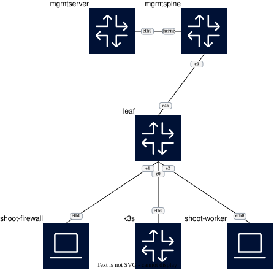

# ACP

  

## IP Addresses and ASNs

### mgmtserver

ASN: 4200010001
lo: 10.100.100.1/32

### mgmtspine

ASN: 4200000001
lo: 10.1.100.1/32
Ethernet0: 10.2.100.1/30

### leaf

ASN: 4200000011
lo: 10.100.100.2/32

### k3s

ASN: 4200000101
lo: 10.100.255.1/32

### shoot-worker

ASN: 4200000202
lo: 10.100.254.2/32

### shoot-fw

ASN: 4200000201
lo: 10.100.254.1/32
vlan1000: 10.100.254.3/32
vlan3000: 10.100.255.2/32

### internet

ASN: 1000
lo: 100.1.1.1/32
